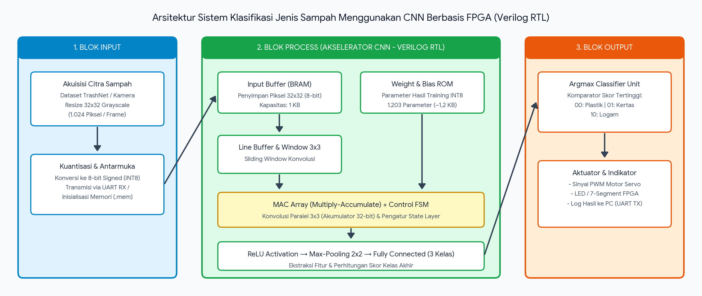

# Waste Classification Using FPGA-Based Convolutional Neural Network (CNN)
*(Klasifikasi Jenis Sampah Menggunakan Convolutional Neural Network Berbasis FPGA)*

-blue)

-green)
-lightgrey)

> **Identitas Mahasiswa:**
> - **Nama:** Farrel Fernanda
> - **NIM:** *1102223030*
> - **Mata Kuliah:** *Desain SoC dan FPGA*

---

## Ringkasan Proyek (Abstrak)

Proyek ini merancang akselerator perangkat keras *Quantized Tiny-CNN* berbasis **Field-Programmable Gate Array (FPGA)** menggunakan bahasa deskripsi perangkat keras **Verilog RTL** untuk mengklasifikasikan tiga jenis sampah anorganik utama, yaitu **Plastik, Kertas/Kardus, dan Logam**. Sistem dibangun dengan pendekatan *hardware-software co-design*, di mana proses *training* dilakukan secara *offline* di PC menggunakan dataset **TrashNet** dengan masukan citra *grayscale* berukuran **32×32 piksel**, kemudian seluruh bobot (*weights*) dan *bias* dikuantisasi menjadi bilangan bulat bertanda 8-bit (**INT8**). Arsitektur perangkat keras pada FPGA dibagi menjadi tiga blok utama: **Blok Input** (*Input Buffer* BRAM dan antarmuka data), **Blok Process** (*Weight ROM*, *Line Buffer*, *Sliding Window* 3×3, *Multiply-Accumulate Array*, aktivasi ReLU, *Max-Pooling* 2×2, *Fully Connected Layer*, serta *Control FSM*), dan **Blok Output** (unit pembanding *Argmax* serta pembangkit sinyal kontrol aktuator/indikator). Model jaringan ini hanya membutuhkan **1.203 parameter (±1,2 KB)** sehingga dapat disimpan sepenuhnya pada memori internal FPGA dengan latensi *inference* yang deterministik, rendah, dan hemat daya.

**Kata Kunci:** *Convolutional Neural Network* (CNN), FPGA, Klasifikasi Sampah, Kuantisasi 8-Bit, Verilog RTL.

---

## Arsitektur Sistem & Diagram Blok (*Input – Process – Output*)

1. **Blok Input (`input_interface`)**
   - **Sumber Data:** Dataset [TrashNet (`garythung/trashnet`)](https://huggingface.co/datasets/garythung/trashnet) yang disaring menjadi 3 kelas (*Plastic*, *Paper*, *Metal*), diubah ukurannya menjadi **32×32 piksel *grayscale*** (1.024 piksel), dan dikuantisasi ke format `signed [7:0]` (INT8).
2. **Blok Process (`cnn_accelerator_core
